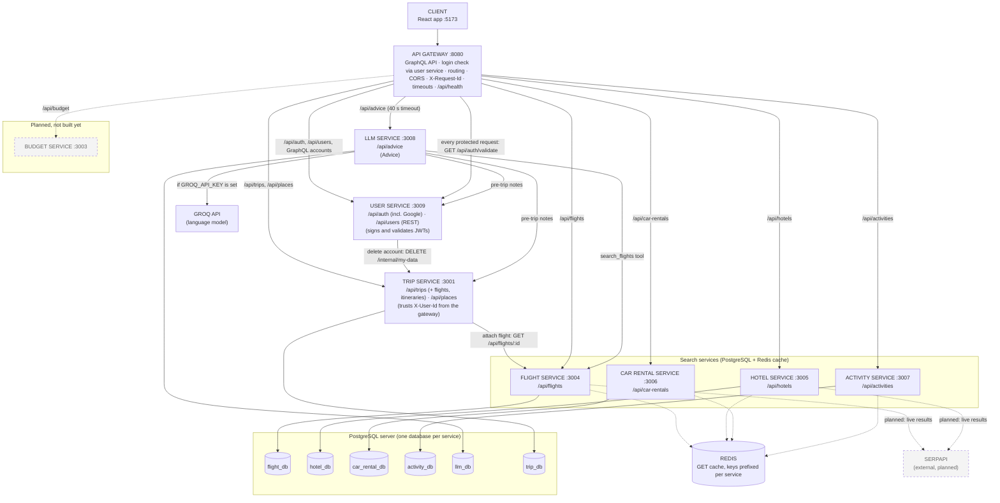
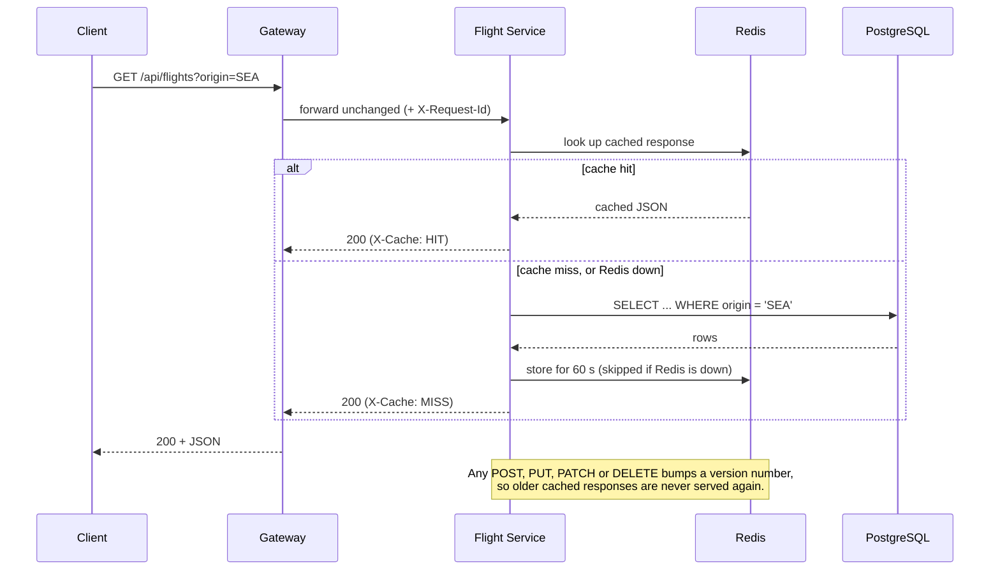
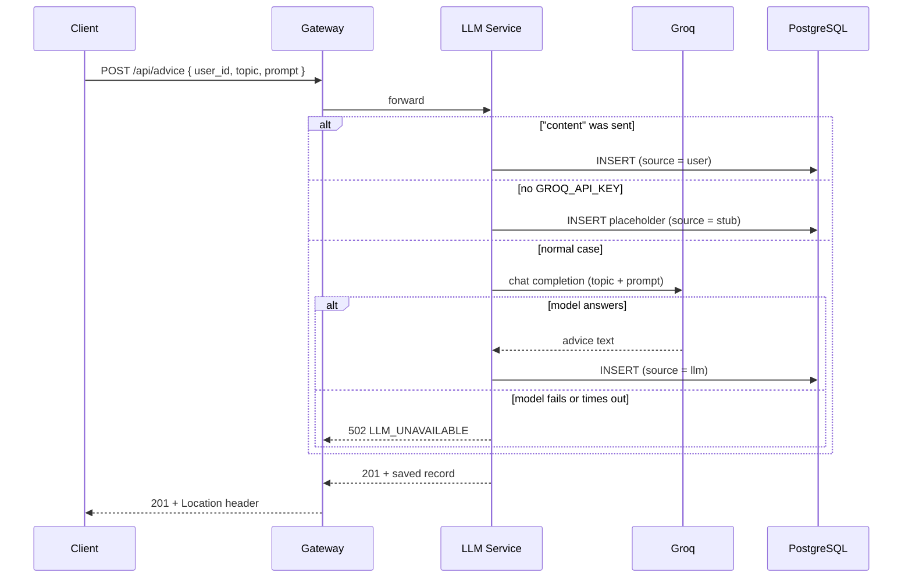
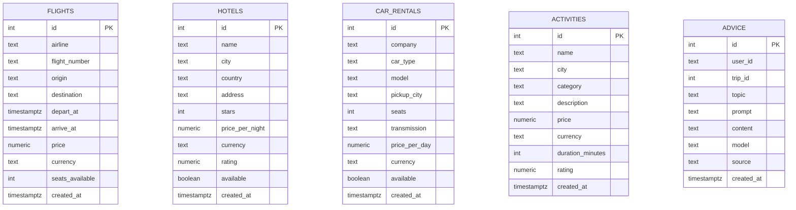
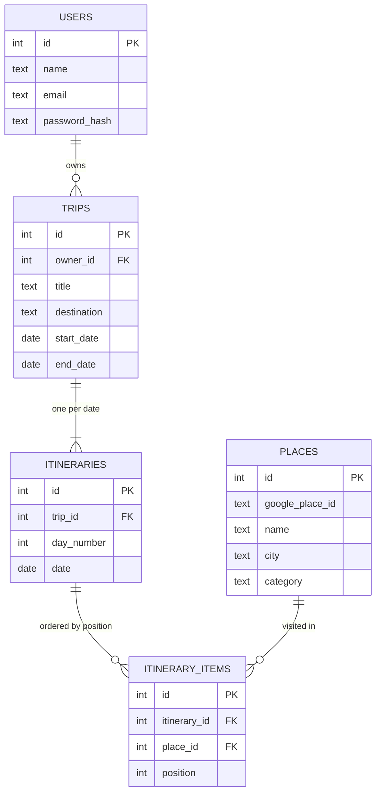

# Travel Assistant: architecture (current state)

Diagrams are [Mermaid](https://mermaid.js.org/) and render on GitHub. Dashed boxes are planned, not built.

## 1. Services



Dotted arrows to Redis mean the cache is optional: if Redis is down, the services read
from PostgreSQL instead.

**The AI component is the LLM service.** It has two chains, and calls other services directly (not through the gateway):
- **Pre-trip notes (fixed chain):** the code reads the traveler from the User service and the trip from the Trip
  service, checks the plan, asks Groq once (no tools) for JSON notes and checks them. Nothing is saved.
- **AI assistant (tool-calling chain):** Groq decides whether to call `search_flights` (the Flight service), at most
  twice per question; the answer is saved in `llm_db`.

## 2. Containers and ports

| Container | Image / folder | Port | Published | Depends on |
|---|---|---|---|---|
| `gateway` | `backend/gateway` | 8080 | `8080` (all clients) | none (answers 502 if a service is down) |
| `frontend` | `frontend` (nginx) | 80 | `5173` | gateway |
| `user-service` | `backend/user-service` | 3009 | no (dev override only) | postgres (healthy) |
| `trip-service` | `backend/trip-service` | 3001 | no (dev override only) | postgres (healthy) |
| `flight-service` | `backend/flight-service` | 3004 | no (dev override only) | postgres (healthy), redis |
| `hotel-service` | `backend/hotel-service` | 3005 | no (dev override only) | postgres (healthy), redis |
| `car-rental-service` | `backend/car-rental-service` | 3006 | no (dev override only) | postgres (healthy), redis |
| `activity-service` | `backend/activity-service` | 3007 | no (dev override only) | postgres (healthy), redis |
| `llm-service` | `backend/llm-service` | 3008 | no (dev override only) | postgres (healthy) |
| `postgres` | `postgres:16` | 5432 | no | none |
| `redis` | `redis:7-alpine` | 6379 | no | none |

Only the gateway and the web app publish ports. Every other service is private to the Docker network.
`docker-compose.dev.yml` is an optional override that opens them on `127.0.0.1` so each service's Swagger UI
(`/docs`) can be browsed during development.

## 3. A cached read (flights, hotels, car rentals, activities)



## 4. Asking the LLM for advice



## 5. Data model (one database per service)



The tables are deliberately separate databases with no foreign keys between them.
`ADVICE.user_id` and `ADVICE.trip_id` point at users and trips owned by the trip service,
so they are plain values, not enforced references.

`trip_db` (trip service) has its own foreign keys inside the one database:



## 6. Where the pieces live

```
Travel-Assistant/
├── docker-compose.yml          all containers, ports, database and cache wiring
├── docs/ARCHITECTURE.md        this file
└── backend/
    ├── gateway/                routing table in src/routes.js, URLs in src/config.js, openapi.yaml
    ├── user-service/           accounts, login, Google sign-in and profiles (REST, src/routes.js)
    ├── trip-service/           trips, trip flights, itineraries (hand-written; see its README.md)
    ├── flight-service/         each CRUD service has the same layout:
    ├── hotel-service/            server.js            start-up
    ├── car-rental-service/       src/resource.js      fields, filters, sample data (the only file that differs)
    ├── activity-service/         src/crud.js          generic CRUD routes and validation
    └── llm-service/              src/llm.js           (LLM service only) Groq call
                                  openapi.yaml, Dockerfile, package.json
```

API reference: `backend/gateway/openapi.yaml` and each service's Swagger UI at `http://localhost:<port>/docs` (with `docker-compose.dev.yml`).
