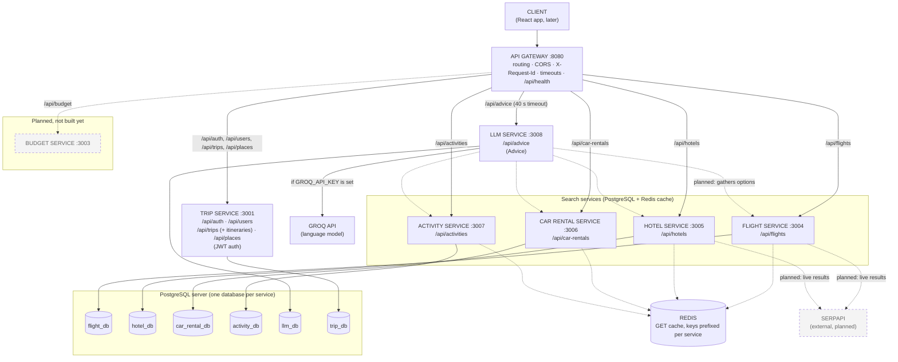
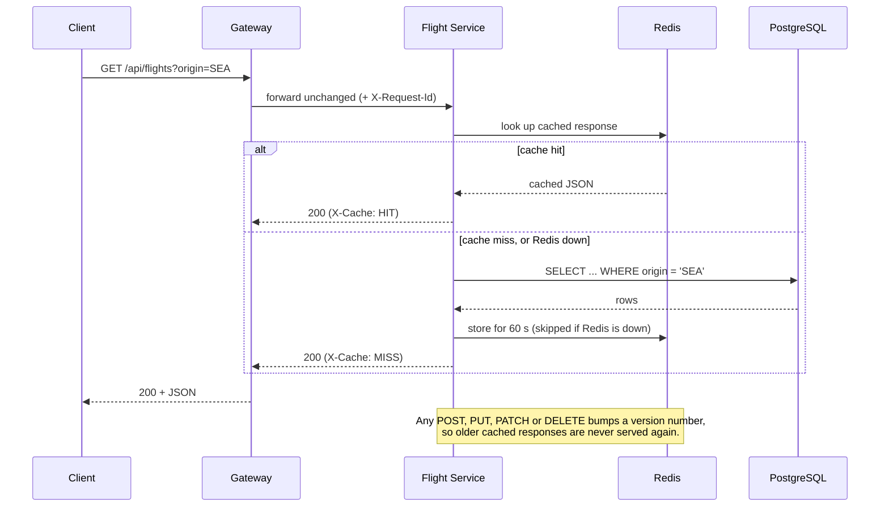
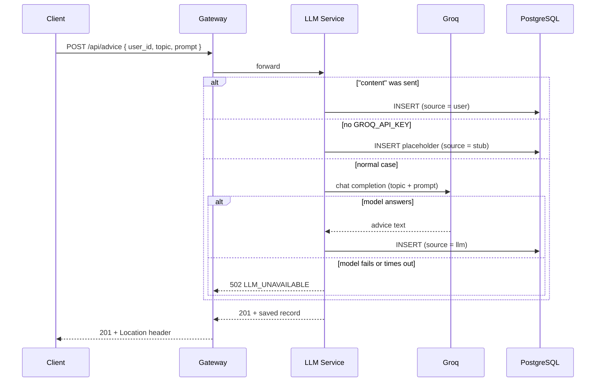
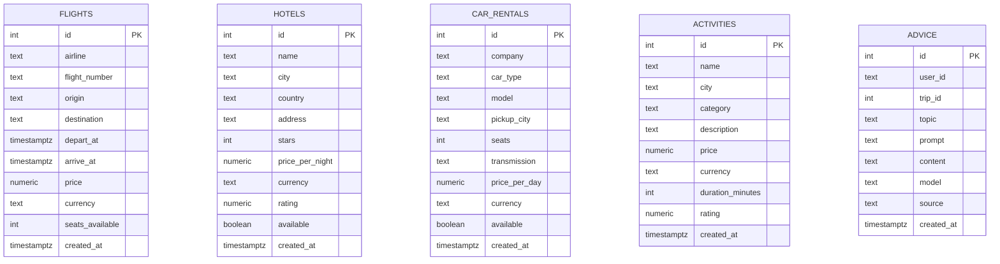
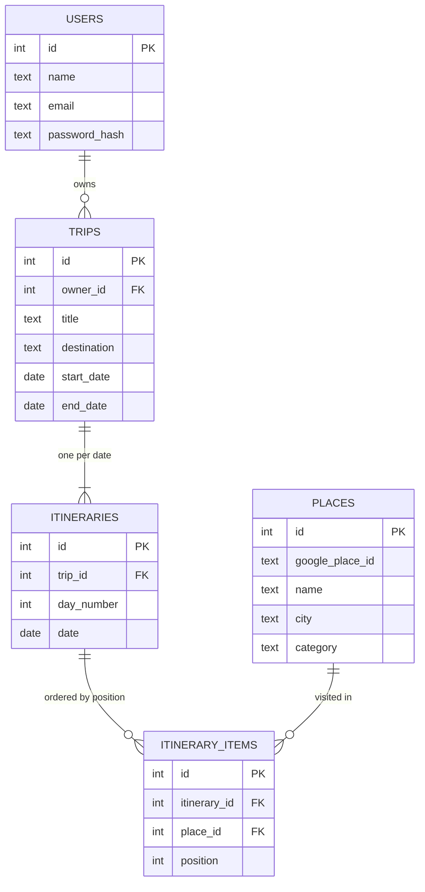

# Travel Assistant: architecture (current state)

Diagrams are [Mermaid](https://mermaid.js.org/), so they render on GitHub and in most Markdown
viewers. Solid boxes exist today. **Dashed boxes are in the plan but not built yet**
(Budget).

## 1. Services



Dotted arrows to Redis mean the cache is optional: if Redis is down, the services read
from PostgreSQL instead.

**The AI component is the LLM service.** Today it saves advice and, when asked, has Groq write
it. In Phase III it will also build a recommendation summary: it calls the Flight, Hotel, Car
Rental and Activity services directly (the dotted arrows from `llm`), lets the model choose
among the results, adds up the cost in code, and saves the result in `llm_db`. There is no
separate agent calling the gateway.

## 2. Containers and ports

| Container | Image / folder | Port | Published | Depends on |
|---|---|---|---|---|
| `gateway` | `backend/gateway` | 8080 | `8080` (all clients) | none (answers 502 if a service is down) |
| `trip-service` | `backend/trip-service` | 3001 | `127.0.0.1:3001` | postgres (healthy) |
| `flight-service` | `backend/flight-service` | 3004 | `127.0.0.1:3004` | postgres (healthy), redis |
| `hotel-service` | `backend/hotel-service` | 3005 | `127.0.0.1:3005` | postgres (healthy), redis |
| `car-rental-service` | `backend/car-rental-service` | 3006 | `127.0.0.1:3006` | postgres (healthy), redis |
| `activity-service` | `backend/activity-service` | 3007 | `127.0.0.1:3007` | postgres (healthy), redis |
| `llm-service` | `backend/llm-service` | 3008 | `127.0.0.1:3008` | postgres (healthy) |
| `postgres` | `postgres:16` | 5432 | no | none |
| `redis` | `redis:7-alpine` | 6379 | no | none |

The `127.0.0.1` ports exist only so each service's Swagger UI (`/docs`) can be opened
during development.

## 3. A cached read (flights, hotels, car rentals, activities)



## 4. Asking the LLM for advice



## 5. Data model (one database per service)



The tables are deliberately separate databases with no foreign keys between them.
`ADVICE.user_id` and `ADVICE.trip_id` point at users and trips owned by the trip service,
so they are plain values, not enforced references.

`trip_db` (trip service) has its own foreign keys inside the one database:



## 6. Where the pieces live

```
Travel-Assistant/
├── docker-compose.yml          all containers, ports, database and cache wiring
├── docs/ARCHITECTURE.md        this file
└── backend/
    ├── gateway/                routing table in src/routes.js, URLs in src/config.js, openapi.yaml
    ├── trip-service/           accounts, trips, itineraries (hand-written; see its README.md)
    ├── flight-service/         each CRUD service has the same layout:
    ├── hotel-service/            server.js            start-up
    ├── car-rental-service/       src/resource.js      fields, filters, sample data (the only file that differs)
    ├── activity-service/         src/crud.js          generic CRUD routes and validation
    └── llm-service/              src/llm.js           (LLM service only) Groq call
                                  openapi.yaml, Dockerfile, package.json
```

API reference: `backend/gateway/openapi.yaml` (everything) and each service's own
`openapi.yaml` / Swagger UI at `http://localhost:<port>/docs`.
